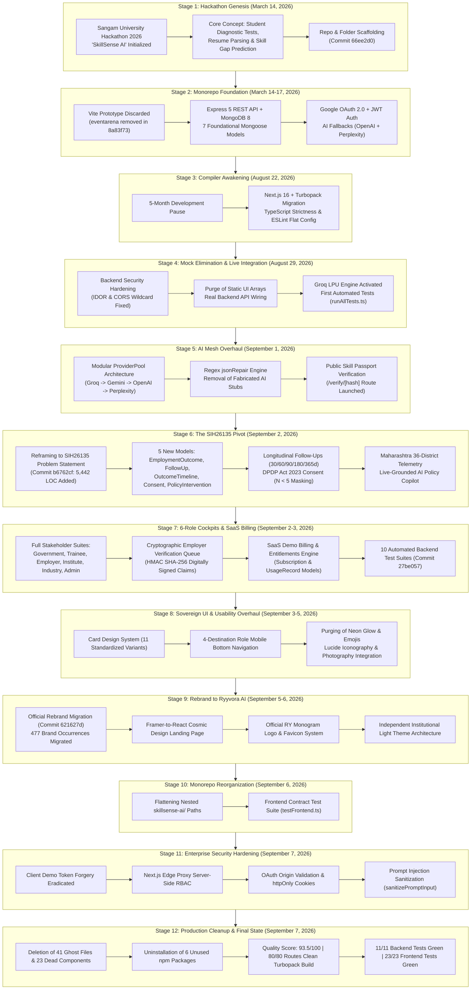
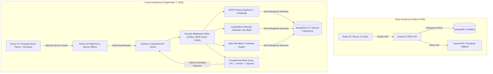
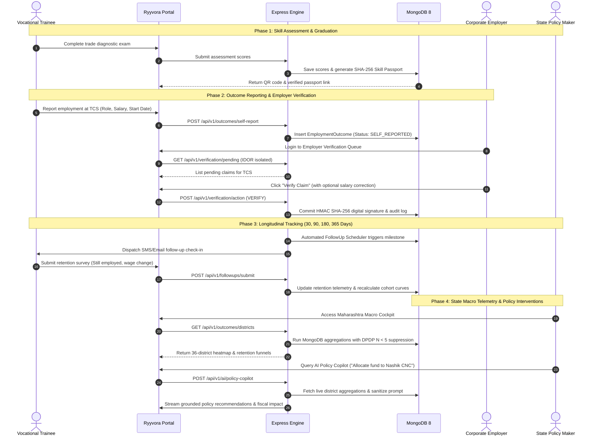
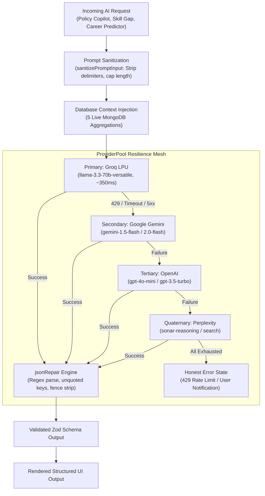

# Ryyvora AI — Visual Project Evolution & Architecture Flow

This document provides visual flowcharts, chronological timelines, and architectural diagrams illustrating the full evolution of **Ryyvora AI** (Smart India Hackathon Problem Statement SIH26135, Team Quantum Coders).

---

## 1. Master Historical Evolution Flow



---

## 2. Chronological Milestones Timeline

```mermaid
timeline
    title Ryyvora AI Development Milestones (March 2026 – September 2026)
    section March 2026: Origin & Prototype
        March 14 : Repository initialized (Commit 66ee2d0)
                 : Initial Sangam University README (Commit 8937900)
                 : Express 5 backend API & Redis cache (Commit 7f35612)
                 : eventarena Vite prototype removed (Commit 8a83f73)
        March 15 : Google OAuth 2.0 integrated (Commit 8b142ac)
                 : Groq primary AI fallback cascade (Commit 0a5c119)
                 : Next.js CVE-2025-66478 patched (Commit 3f44b0f)
        March 17 : Dashboard prototype stabilization (Commit f0266bb)
    section August 2026: Modernization & Live Integration
        August 22 : Next.js 16 & Turbopack build migration (Commit a3d9427)
        August 29 : IDOR fix & first backend test suites (Commit ac85e48)
                  : Purge of static mocks & live API wiring (Commit d297c6d)
                  : Groq LPU engine activated with SSE (Commit 8c6aab7)
    section Early September 2026: The SIH Pivot & Ecosystem Expansion
        September 1 : ProviderPool & jsonRepair engine (Commit e895c6f)
                    : Public Skill Passport verification (Commit 57f168d)
                    : Google Gemini LLM integration (Commit 463c4bc)
        September 2 : The SIH26135 Pivot Commit (Commit b6762cf)
                    : Longitudinal tracking, 5 new models, DPDP consent
                    : 6-Role stakeholder cockpits built (Government, Trainee, Employer)
                    : SaaS billing engine & entitlement gates (Commit d17c230)
        September 3 : 10 Automated backend test suites (Commit 27be057)
                    : Mobile bottom navigation 4-destination bar (Commit a1cdf88)
                    : Standardized 11-variant Card Design System (Commit 2e236d2)
        September 4 : Sovereign Institutional design system (Commit e4d9a62)
                    : Photographic assets & emoji purging (Commit fdcc3db)
    section September 5-7, 2026: Rebranding, Hardening & Cleanup
        September 5 : Official Rebrand to Ryyvora AI (Commit 621627d)
                    : Framer-to-React cosmic landing page (Commit 6dc7065)
        September 6 : End-to-end real AI features (Commit 4afa307)
                    : Monorepo folder flattening & reorganization (Commit d68e819)
                    : Official RY monogram logo & favicon system (Commit d223ef7)
                    : Institutional light mode redesign (Commit eef4788)
        September 7 : Comprehensive application security hardening (Commit 3544b29)
                    : Landing page demo access removal
                    : Production code cleanup (70 files & 6 packages removed)
                    : Quality Score: 93.5/100 | 11/11 & 23/23 tests passing
```

---

## 3. Architecture Evolution: Early vs. Current



---

## 4. SIH26135 Workforce Outcome Lifecycle



---

## 5. Multi-Provider AI Fallback Mesh



---

## 6. Security Defense-in-Depth Pipeline

```mermaid
flowchart LR
    Browser["Client Browser Request"] --> EdgeProxy["Next.js 16 Edge Proxy<br/>(proxy.ts)"]

    subgraph EDGE_LAYER ["Edge Verification"]
        EdgeProxy -->|Check Path| RouteType{"Is Route Protected?"}
        RouteType -->|No (Public / Landing)| AllowPublic["Serve Public Page"]
        RouteType -->|Yes (/admin, /government, etc.)| ValidateCookie{"Check ryyvora_token Cookie"}
        ValidateCookie -->|Missing / Fake Token| RedirectLogin["302 Redirect to /auth"]
        ValidateCookie -->|Valid JWT| CheckRole{"Edge Role Authorization"}
        CheckRole -->|Unauthorized Role| ForbiddenRedirect["302 Redirect to User Role Root"]
        CheckRole -->|Authorized Role| ForwardBackend["Forward to Express API"]
    end

    subgraph API_LAYER ["Express 5 Hardened Core"]
        ForwardBackend --> OriginCheck["Strict CORS & Trusted Origins"]
        OriginCheck --> RateLimit["Route Rate Limiters (Auth, AI, Public)"]
        RateLimit --> AuthMiddleware["JWT Verify & Cookie Guard"]
        AuthMiddleware --> IDORGuard["Multi-Tenant IDOR Guard (employerId)"]
        IDORGuard --> DPDPCheck["DPDP Act Purpose & N < 5 Masking"]
        DPDPCheck --> ServiceExec["Execute Business Logic & Database Commit"]
    end
```
